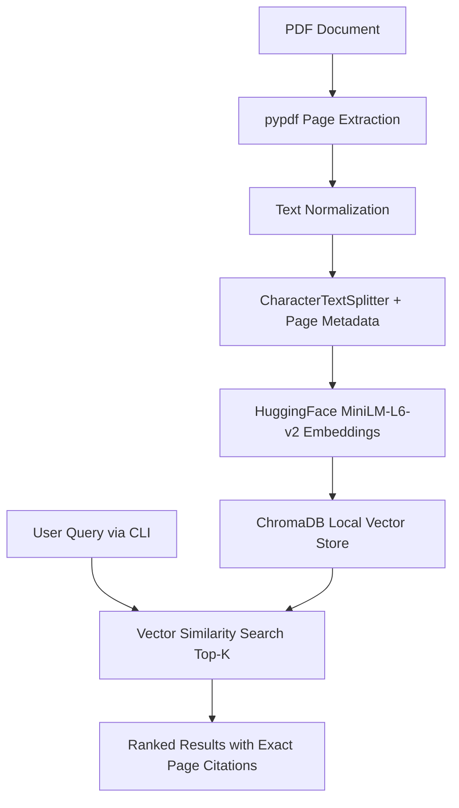

# Gen-AI PDF Semantic Search & Retrieval (RAG)

A modular, local semantic search and Question-Answering retrieval system for PDF documents built with **LangChain**, **ChromaDB**, and **HuggingFace Embeddings (`sentence-transformers/all-MiniLM-L6-v2`)**.

---

## Architecture & Pipeline



1. **Extraction**: Reads pages sequentially using `pypdf`, normalizing irregular whitespace.
2. **Chunking**: Splits pages into 500-character segments with 100-character overlap while tagging each chunk with its exact source page metadata.
3. **Embedding**: Transforms textual chunks into dense vector representations using `all-MiniLM-L6-v2`.
4. **Indexing**: Stores vectors and metadata locally in ChromaDB under `chroma_db/`.
5. **Retrieval**: Performs cosine similarity matching against user queries and surfaces top-$k$ ranked passages with page citations.

---

## Tech Stack

| Component | Technology | Description |
| :--- | :--- | :--- |
| **Package Manager** | `uv` | Ultra-fast Python package and project manager |
| **PDF Extraction** | `pypdf` | Native pure-Python PDF reader |
| **Orchestration** | `langchain` / `langchain-text-splitters` | Text splitting, document modeling, and metadata retention |
| **Embeddings** | `langchain-huggingface` (`all-MiniLM-L6-v2`) | Local, high-efficiency sentence embedding model |
| **Vector Store** | `langchain-chroma` (`chromadb`) | Embedded vector database with local persistence |

---

## Project Structure

```
.
├── Individual_Contributor_License_Agreement.pdf  # Target source PDF document
├── main.py                                      # Modular application logic (extraction, indexing, CLI)
├── pyproject.toml                               # uv project manifest
├── requirements.txt                             # Dependency specifications
├── uv.lock                                      # Locked dependency graph
├── .gitignore                                   # Excludes virtualenvs, cache, and DB binaries
└── README.md                                    # Project documentation
```

---

## Prerequisites

- **Python**: 3.10 or higher
- **`uv`**: Recommended for dependency resolution and execution.
  ```bash
  # macOS / Linux
  curl -LsSf https://astral.sh/uv/install.sh | sh

  # Homebrew (macOS)
  brew install uv
  ```

---

## Step-by-Step Setup Guide

### 1. Clone the Repository
```bash
git clone https://github.com/rishav-raj-genx/Gen-AI-P3.git
cd Gen-AI-P3
```

### 2. Create the Virtual Environment
```bash
uv venv
```

### 3. Install Dependencies
```bash
uv pip install -r requirements.txt
```

---

## Running the Application

Execute the application through `uv run`:

```bash
uv run python main.py
```

### Interactive CLI Walkthrough

Upon launching, the script will automatically inspect the local directory, extract and index the document, and prompt for queries:

```text
Loading PDF: Individual_Contributor_License_Agreement.pdf (3 pages)
Page 1 extracted (9 chunks)
Page 2 extracted (8 chunks)
Page 3 extracted (1 chunks)
PDF processing complete: 18 total chunks created.
Embedding model loaded successfully!
Loaded existing ChromaDB index.

========================================
         PDF CHATBOT READY
========================================
Ask questions about the document.
Type 'exit' to quit.

You: grant of copyright license

Relevant Passages:

[1] Page 1:
by the Project a perpetual, worldwide, non- exclusive, no-charge, royalty-free, irrevocable copyright license to reproduce, prepare derivative works
--------------------------------------------------
[2] Page 2:
legally entitled to grant the above license. If your employer(s) has rights to intellectual property that you create that includes your Contributions...
--------------------------------------------------

You: exit
Exiting chatbot.
```

---

## Customization

### Using Your Own PDF
Drop any `.pdf` file into the root folder. The loader automatically defaults to `Individual_Contributor_License_Agreement.pdf`, or falls back to the first `.pdf` located in the workspace.

### Adjusting Chunk Parameters
In `main.py`, modify chunk size and overlap inside `extract_and_chunk_pdf()`:
```python
text_splitter = CharacterTextSplitter(
    separator=" ",
    chunk_size=500,     # Characters per chunk
    chunk_overlap=100,  # Overlap across consecutive chunks
    length_function=len
)
```

### Resetting the Vector Store
To rebuild the vector database from scratch (e.g., when adding a new PDF), remove the local database directory:
```bash
rm -rf chroma_db/
```
The application will automatically recreate and reindex the vector store on the next run.
